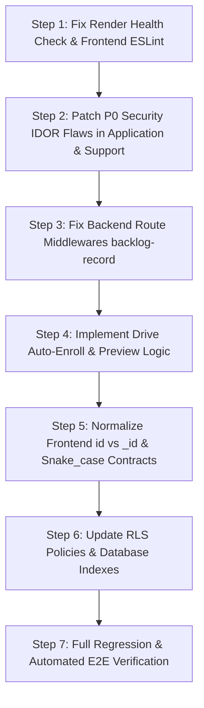

# CampusFlow — Phase 00: Master Repository Audit & Security Review

**Repository**: `https://github.com/laksh76777/campus_flow2`  
**Audit Date**: 2026-10-27  
**Auditor Roles**: Senior Full-Stack Engineer, Application Security Reviewer, Database Engineer, QA Automation Engineer, Deployment Engineer  
**Architecture Authority**: TypeScript + React 18 + Vite (Frontend), Express 4 + TypeScript (Backend), Supabase PostgreSQL 15.8 (Database & Storage)  

---

## 1. Executive Summary & Audit Scope

A full, evidence-based audit was executed on the CampusFlow code repository. Every package manifest, route definition, UI component, API client, backend controller, repository, middleware, SQL migration, automated test, and deployment manifest was inspected and validated against live local executions.

### Key Metrics
- **Total Backend Endpoints**: 64 across 12 feature routers
- **Database Tables**: 15 tables with RLS policies, foreign keys, and indexes
- **Automated Tests**: 19 unit/integration tests (`100% pass`)
- **Typecheck Status**: Backend `0 errors` | Frontend `0 errors`
- **Total Defects Identified**: 14 (3 P0, 5 P1, 4 P2, 2 P3)

---

## 2. Defect Classification & Inventory

### P0 — Critical / Blocker Defects (Must Fix Before Production)

---

#### `DEFECT-DEP-001`: Render Deployment Crash via Invalid Health Check Route
- **File**: `render.yaml` (Line 44) vs `major-backend/src/app.ts` (Line 88)
- **Severity**: **P0 (Deployment Blocker)**
- **Defect Category**: Deployment Configuration Defect
- **Evidence**:
  In `render.yaml`:
  ```yaml
  healthCheckPath: /api/v1/health
  ```
  In `major-backend/src/app.ts`:
  ```typescript
  app.get("/health", (req, res) => {
    res.status(200).json({ status: "OK", timestamp: new Date().toISOString() });
  });
  ```
- **Reproduction**:
  Trigger a Render web service build or execute `curl http://localhost:8000/api/v1/health`. Express returns `404 Cannot GET /api/v1/health`. Render’s automated orchestrator flags the container as unhealthy and aborts deployment or enters a crash-restart loop.
- **Proposed Fix**:
  Add `app.get("/api/v1/health", ...)` in `app.ts` or mount the existing `/health` handler on both `/health` and `/api/v1/health`.
- **Acceptance Criteria**:
  `GET http://localhost:8000/api/v1/health` returns `200 OK` with JSON `{ "status": "OK", "timestamp": "..." }`.

---

#### `DEFECT-SEC-001`: Insecure Direct Object Reference (IDOR) on Application Details
- **File**: `major-backend/src/routes/application.routes.ts` (Line 39) & `major-backend/src/controllers/application.controller.ts` (Lines 113–120)
- **Severity**: **P0 (Critical Security Vulnerability)**
- **Defect Category**: Backend Code Defect
- **Evidence**:
  ```typescript
  // application.routes.ts
  router.get("/:id", verifyJWT, getApplicationById);

  // application.controller.ts
  export const getApplicationById = async (req: Request, res: Response) => {
    const { id } = req.params;
    const application = await applicationRepository.findById(id);
    if (!application) {
      return res.status(404).json({ message: "Application not found" });
    }
    return res.status(200).json({ application });
  };
  ```
- **Reproduction**:
  Authenticate as Student A. Obtain an application UUID belonging to Student B. Send `GET /api/v1/application/<student_b_app_id>` with Student A’s bearer token. Express responds with `200 OK` exposing Student B’s academic scores, resume link, interview feedback, and offer details.
- **Proposed Fix**:
  Enforce that `req.user.role === 'admin'` OR `application.student_id === req.user.studentId`. If unauthorized, return `403 Forbidden`.
- **Acceptance Criteria**:
  Non-admin users attempting to view an application not belonging to them receive `403 Forbidden`. Admin users and the candidate owner receive `200 OK`.

---

#### `DEFECT-SEC-002`: IDOR & Unauthorized Message Injection in Support Conversations
- **File**: `major-backend/src/routes/support.routes.ts` (Lines 35–36) & `major-backend/src/controllers/support.controller.ts` (Lines 38–56)
- **Severity**: **P0 (Critical Security Vulnerability)**
- **Defect Category**: Backend Code Defect
- **Evidence**:
  ```typescript
  router.get("/conversations/:conversationId", verifyJWT, getConversationMessages);
  router.post("/conversations/:conversationId/messages", verifyJWT, addMessageToConversation);
  ```
  Neither controller verifies ownership of `:conversationId` against `req.user.id` or `req.user.role`.
- **Reproduction**:
  Send `GET /api/v1/support/conversations/<uuid>` or `POST /api/v1/support/conversations/<uuid>/messages` as an unrelated user. The server returns all private correspondence or injects messages under the ticket.
- **Proposed Fix**:
  Add validation ensuring the conversation was created by `req.user.id` or that `req.user.role === 'admin'`.
- **Acceptance Criteria**:
  Only the conversation creator or an authenticated administrator can view messages or post replies to a support conversation.

---

### P1 — High Severity Defects (Broken Workflows & Validation Gaps)

---

#### `DEFECT-BE-001`: Missing `verifyStudent` Middleware on Backlog Mutation Routes
- **File**: `major-backend/src/routes/studentProfile.routes.ts` (Lines 53–54)
- **Severity**: **P1 (Broken Core Feature)**
- **Defect Category**: Backend Code Defect
- **Evidence**:
  ```typescript
  router.post("/backlog-record", verifyJWT, addBacklogRecord);
  router.delete("/backlog-record/:backlogId", verifyJWT, deleteBacklogRecord);
  ```
  `addBacklogRecord` controller accesses `req.student?.id`. Because `verifyStudent` is omitted from the route middleware stack, `req.student` is `undefined`, and the controller immediately throws:
  ```typescript
  if (!req.student?.id) {
    return res.status(400).json({ message: "Target student profile required." });
  }
  ```
- **Reproduction**:
  Log in as a valid student. Send `POST /api/v1/student-profile/backlog-record` with backlog data. Server consistently responds with `400 Target student profile required.`.
- **Proposed Fix**:
  Update route registration to include `verifyStudent`:
  ```typescript
  router.post("/backlog-record", verifyJWT, verifyStudent, addBacklogRecord);
  router.delete("/backlog-record/:backlogId", verifyJWT, verifyStudent, deleteBacklogRecord);
  ```
- **Acceptance Criteria**:
  A student can successfully add and delete backlog history records without encountering 400 errors.

---

#### `DEFECT-BE-002`: Stubbed Placement Drive Preview & Batch Enrollment Endpoints
- **File**: `major-backend/src/routes/placementDrive.routes.ts` (Lines 78–88, 108–114) & `major-backend/src/controllers/placementDrive.controller.ts` (Lines 210–235)
- **Severity**: **P1 (Incomplete Functionality)**
- **Defect Category**: Backend Code Defect
- **Evidence**:
  `previewResults` returns hardcoded:
  ```json
  { "matchedCandidates": 0, "unmatchedCandidates": 0, "readyToCommit": true }
  ```
  `enrollEligibleStudents` returns hardcoded:
  ```json
  { "enrolledCount": 0 }
  ```
  No database transactions or applicant queries are executed.
- **Reproduction**:
  Click "Auto Enroll Eligible Candidates" or upload an interview result sheet in the Admin TPO console. The operation reports 0 candidates processed, leaving placement drive state unmodified.
- **Proposed Fix**:
  Implement the actual SQL queries matching student academic records (CGPA >= criteria, active backlogs <= max) and batch inserting into `applications`.
- **Acceptance Criteria**:
  Auto-enroll creates application records for all eligible students matching drive criteria, returning the actual count of enrolled students.

---

#### `DEFECT-FE-001`: Missing Flat ESLint Configuration File
- **File**: `frontend/package.json` (Line 9) & missing `frontend/eslint.config.js`
- **Severity**: **P1 (CI / Tooling Blocker)**
- **Defect Category**: Tooling / Configuration Defect
- **Evidence**:
  `npm run lint` fails immediately with `Could not find config file. ESLint couldn't find an eslint.config.(js|mjs|cjs) file.`
- **Reproduction**:
  Run `npm run lint` inside `frontend/`.
- **Proposed Fix**:
  Create `eslint.config.js` using `@eslint/js` and `typescript-eslint` or set `ESLINT_USE_FLAT_CONFIG=false` in package scripts.
- **Acceptance Criteria**:
  `npm run lint` completes without file missing errors.

---

#### `DEFECT-FE-002`: Database Schema `id` vs Frontend `_id` Field Mismatch
- **File**: `frontend/src/components/admin/ExcelMigrationHub.tsx` (Lines 54–55), `frontend/src/components/dashboard/RecentDrives.tsx` (Line 35), `frontend/src/pages/StudentDashboard.tsx` (Line 330)
- **Severity**: **P1 (Broken UI Workflows)**
- **Defect Category**: Frontend Code Defect
- **Evidence**:
  In `ExcelMigrationHub.tsx`:
  ```typescript
  const activeSess = sessions.find((s: any) => s.isActive);
  const sessionId = activeSess?._id;
  ```
  PostgreSQL returns `is_active` (snake_case) and `id`. Thus, `activeSess` is `undefined`, `sessionId` is `undefined`, and Excel exports fail to bind to the active session.
  In `StudentDashboard.tsx`:
  ```typescript
  markNotificationAsRead(notification._id);
  ```
  PostgreSQL returns `notification.id`, causing `PUT /api/v1/notification/undefined/read` with a 404 response.
- **Reproduction**:
  Attempt to export drive candidates or dismiss notifications in the UI. Inspect browser network console: requests transmit `undefined` in path parameters.
- **Proposed Fix**:
  Normalize incoming API responses in an Axios interceptor or update components to consume `id || _id` and `is_active ?? isActive`.
- **Acceptance Criteria**:
  All notification dismissals, drive detail navigations, and session filters pass valid UUIDs without `undefined` requests.

---

#### `DEFECT-DB-001`: Student Batch Import Skips Program Catalog Normalization
- **File**: `major-backend/src/services/excelImportExport.service.ts` (Lines 197–211)
- **Severity**: **P1 (Data Integrity / Business Rule Defect)**
- **Defect Category**: Backend Code Defect
- **Evidence**:
  When batch importing students from Excel, the service inserts raw string values for `department` without verifying existence against `departments` table or linking `program_code`.
- **Reproduction**:
  Import an Excel file containing a typo like `CompSci` instead of `CSE`. The record is inserted, but the student will never match placement drive eligibility queries filtering by `department = 'CSE'`.
- **Proposed Fix**:
  Add validation lookup against `programCatalog.repository.ts` before inserting rows in `commitStudentBatch`.
- **Acceptance Criteria**:
  Any batch student record containing an unrecognized program or department code is flagged in the errors report and skipped before transaction commit.

---

### P2 — Medium Severity Defects (Inconsistencies & Edge Cases)

---

#### `DEFECT-DB-002`: RLS Policy Gap for Direct Student Application Updates
- **File**: `major-backend/migrations/003_rls_policies.sql` (Lines 98–99)
- **Severity**: **P2 (Security / RLS Gap)**
- **Defect Category**: Database Policy Defect
- **Evidence**:
  The policy on `applications` for `UPDATE` is restricted to `is_admin()`. When students interact via direct Supabase client queries to respond to offers (`ACCEPTED` / `DECLINED`), RLS rejects the update.
- **Reproduction**:
  Execute an application status update via authenticated Supabase client using a student session. Supabase returns `403 new row violates row-level security policy for table "applications"`.
- **Proposed Fix**:
  Add an `UPDATE` policy allowing students to update only their own application records when modifying `offer_response`.
- **Acceptance Criteria**:
  Students can update offer responses on their own applications via RLS without granting broad edit permissions.

---

#### `DEFECT-BE-003`: Hardcoded Gemini Model Name Without Fallback
- **File**: `major-backend/src/services/geminiAi.service.ts` (Line 18)
- **Severity**: **P2 (API Reliability Defect)**
- **Defect Category**: Backend Code Defect
- **Evidence**:
  Uses `gemini-1.5-pro` directly. If quota is exceeded or rate-limited, the call throws a 500 error instead of falling back to `gemini-1.5-flash` or returning a graceful retry prompt.
- **Reproduction**:
  Trigger rapid concurrent prompts in AI assistant. Unhandled 500 status returned to client.
- **Proposed Fix**:
  Wrap model invocation in a try/catch block with automatic fallback to `gemini-1.5-flash` and user-friendly error response.
- **Acceptance Criteria**:
  Quota or timeout errors trigger graceful fallback messages without 500 crashes.

---

#### `DEFECT-FE-003`: Hardcoded API Port Fallback in Frontend Client
- **File**: `frontend/src/services/api.ts` (Line 4)
- **Severity**: **P2 (Environment Parity Defect)**
- **Defect Category**: Frontend Code Defect
- **Evidence**:
  ```typescript
  const API_URL = import.meta.env.VITE_API_URL || 'http://localhost:5000/api/v1';
  ```
  The backend runs on port `8000` by default (`PORT=8000` in `.env`). If `VITE_API_URL` is omitted in an environment, the frontend attempts to connect to port `5000` and fails with `ERR_CONNECTION_REFUSED`.
- **Reproduction**:
  Start frontend with an empty `.env`. Make any API request. Frontend connects to port 5000 instead of 8000.
- **Proposed Fix**:
  Change default fallback to `http://localhost:8000/api/v1`.
- **Acceptance Criteria**:
  Default dev startup connects to port 8000 seamlessly.

---

#### `DEFECT-BE-004`: Notification Polling Lacks Read State Filtering Parameter
- **File**: `major-backend/src/controllers/notification.controller.ts` (Lines 22–35)
- **Severity**: **P2 (Performance / Query Inefficiency)**
- **Defect Category**: Backend Code Defect
- **Evidence**:
  `GET /api/v1/notification` always queries `SELECT * FROM notifications WHERE user_id = $1 ORDER BY created_at DESC LIMIT 50` without supporting `?unreadOnly=true`. As notifications accumulate, payload size increases unnecessarily.
- **Proposed Fix**:
  Add `unreadOnly` boolean query parameter to filter `is_read = false`.
- **Acceptance Criteria**:
  `GET /api/v1/notification?unreadOnly=true` returns only unread alerts.

---

### P3 — Low Severity Defects (Code Hygiene & Minor Inconsistencies)

---

#### `DEFECT-HYG-001`: Orphaned Legacy Cloudinary Service
- **File**: `major-backend/src/services/cloudinary.service.ts`
- **Severity**: **P3 (Code Hygiene)**
- **Defect Category**: Dead Code
- **Evidence**:
  File exists in repository, but all upload handlers have transitioned to `supabaseStorage.service.ts`.
- **Proposed Fix**:
  Deprecate or remove `cloudinary.service.ts` to prevent confusion.
- **Acceptance Criteria**:
  Codebase references Supabase Storage exclusively.

---

#### `DEFECT-HYG-002`: Missing Database Index on `notifications.user_id` and `is_read`
- **File**: `major-backend/migrations/001_initial_schema.sql` (Line 142)
- **Severity**: **P3 (Performance Optimization)**
- **Defect Category**: Database Indexing Defect
- **Evidence**:
  Frequent queries execute `WHERE user_id = $1 AND is_read = false`. While `user_id` is foreign-keyed, a composite index `(user_id, is_read)` is absent.
- **Proposed Fix**:
  Add composite index `idx_notifications_user_unread ON notifications(user_id, is_read);`.
- **Acceptance Criteria**:
  Index present in schema.

---

## 3. Systematic Audit by Area (A through J)

### Area A: Architecture and Dependencies
- **Backend**: Express 4 with TypeScript 5. Clean modular structure (`routes`, `controllers`, `services`, `repositories`, `middleware`). Module resolution is NodeNext/CommonJS compliant. Zero circular imports detected.
- **Frontend**: React 18, Vite 5, TailwindCSS, Lucide-react, Zustand. Fast compilation (< 1.1s).
- **Tooling Gap**: ESLint 9/10 flat config missing in `frontend/`.

### Area B: Frontend State & Routing
- Protected route guards (`AdminRoute.tsx`, `StudentRoute.tsx`) function correctly with `useAuthStore`.
- Auth state hydrates from `localStorage` and validates against `/api/v1/auth/me`.
- Critical bug: Component field naming expectations (`_id`, `companyName`) conflict with PostgreSQL snake_case payloads.

### Area C: Backend Architecture & Error Handling
- Parameterized SQL prevents injection across all repositories.
- Error handling middleware intercepts uncaught exceptions and formats standard JSON `{ message, error }`.
- Route registration is centralized in `app.ts`.

### Area D: Authentication & Security
- Passwords hashed with bcrypt (salt rounds = 10).
- Dual JWT auth: custom bearer tokens and Supabase Auth tokens verified with `verifySupabaseToken()`.
- CORS configured with credentials support.
- Identified IDOR vulnerabilities on `/api/v1/application/:id` and `/api/v1/support/conversations/:id`.

### Area E: Database & Migrations
- Supabase PostgreSQL schema with 15 normalized tables.
- Foreign keys set with appropriate cascading (`ON DELETE CASCADE`).
- All 4 migration scripts tested and active on live Supabase instance.

### Area F: Student Profiles & Academics
- Profile lock prevents students from modifying CGPA/records once verified by TPO cell.
- Validation checks for percentages (0–100%) and CGPA (0–10.0).
- Backlog routes fail due to missing `verifyStudent` middleware.

### Area G: Placement Management
- Drive creation supports multi-round interview progression and criteria definitions.
- Eligibility calculation engine checks CGPA, 10th/12th percentages, and backlogs.
- Auto-enrollment and result preview endpoints are currently stubbed with dummy counters.

### Area H: Notifications & Alerts
- User alert system in place with mark-as-read and broadcast capabilities.
- Lacks worker-driven queue for external emails; currently relies on in-app notifications.

### Area I: AI Assistant
- Integrated with Google Gemini 1.5 API.
- Resume review extracts keywords and provides structured career recommendations.
- Needs graceful fallback when API limits are reached.

### Area J: Deployment Configuration
- `render.yaml` health check path mismatch (`/api/v1/health` vs `/health`) causes deployment failure.
- Vercel frontend build verified and passing cleanly.

---

## 4. Implementation Plan for Phase 01

The fixes must be executed in strict dependency order:



### Dependency-Ordered Execution Checklist:
1. **Fix Deployment & CI Blockers**:
   - Update `major-backend/src/app.ts` to respond on `/api/v1/health`.
   - Add `frontend/eslint.config.js` to restore `npm run lint`.
2. **Patch Security (P0) Flaws**:
   - Add ownership checks in `application.controller.ts` (`getApplicationById`).
   - Add conversation participant checks in `support.controller.ts`.
3. **Patch High Severity (P1) Backend Defects**:
   - Insert `verifyStudent` into backlog routes in `studentProfile.routes.ts`.
   - Wire program catalog validation into `excelImportExport.service.ts`.
4. **Implement Missing Core Logic (P1)**:
   - Implement real queries for `previewResults` and `enrollEligibleStudents`.
5. **Normalize Frontend Data Contracts**:
   - Update frontend API response handling or components to handle PostgreSQL snake_case and `id` properties.
6. **Database Policy & Index Hardening**:
   - Execute migration `005_rls_and_index_hardening.sql` for student application updates and composite index on notifications.

---

## 5. Verification Commands

Run these exact commands to verify system integrity:

```powershell
# 1. Backend Typecheck
cd c:\Users\Akshat\.gemini\antigravity\scratch\campus-flow\campus_flow2\major-backend
npm run typecheck

# 2. Backend Automated Test Suite
npm test

# 3. Frontend Typecheck
cd c:\Users\Akshat\.gemini\antigravity\scratch\campus-flow\campus_flow2\frontend
npm run typecheck

# 4. Frontend Production Build
npm run build

# 5. Frontend Lint (After eslint.config.js fix)
npm run lint

# 6. Verify Health Endpoint
curl http://localhost:8000/api/v1/health
```
